<!-- ==================== 标题画面 ==================== -->

<h1>你好，我是 jieefeng 👋</h1>

<picture>
  <source media="(prefers-color-scheme: dark)" srcset="./assets/typing-card.svg" />
  <source media="(prefers-color-scheme: light)" srcset="./assets/typing-card-light.svg" />
  
</picture>

  <kbd>↑</kbd><kbd>↑</kbd><kbd>↓</kbd><kbd>↓</kbd><kbd>←</kbd><kbd>→</kbd><kbd>←</kbd><kbd>→</kbd><kbd>B</kbd><kbd>A</kbd>

按了没反应是正常的 —— 这里跑不了 JavaScript，不过下面每一屏都是真跑出来的。

  <picture>
    <source media="(prefers-color-scheme: dark)" srcset="./assets/daily-card.svg" />
    <source media="(prefers-color-scheme: light)" srcset="./assets/daily-card-light.svg" />
    
  </picture>

---

<!-- ==================== 任务日志 ==================== -->

<h2 align="center">📜 任务日志</h2>

  <picture>
    <source media="(prefers-color-scheme: dark)" srcset="./assets/quest-card.svg" />
    <source media="(prefers-color-scheme: light)" srcset="./assets/quest-card-light.svg" />
    
  </picture>

---

<!-- ==================== 装备栏 ==================== -->

<h2 align="center">🎒 装备栏</h2>

  <picture>
    <source media="(prefers-color-scheme: dark)" srcset="./assets/inventory-card.svg" />
    <source media="(prefers-color-scheme: light)" srcset="./assets/inventory-card-light.svg" />
    
  </picture>

---

<!-- ==================== 贡献跑酷（本地生成 · 每日自动更新） ==================== -->

<h2 align="center">🏃 贡献跑酷</h2>

  <picture>
    <source media="(prefers-color-scheme: dark)" srcset="./assets/activity-card.svg" />
    <source media="(prefers-color-scheme: light)" srcset="./assets/activity-card-light.svg" />
    
  </picture>

  每周的贡献量堆成地形，小人跑完这一年的坡；沿途亮着的宝石，是真正有产出的那几周。

---

<!-- ==================== 访客统计 ==================== -->

  

---

🎁 隐藏关卡 · 点开有奖励

 

<samp>STAGE CLEAR · BONUS STAGE UNLOCKED</samp>

  <kbd>+1 好奇心</kbd> <kbd>+1 好运（下次 debug 用得上）</kbd> <kbd>+0 大道理</kbd>

  真正的奖励是你读到了这里。祝你今天编译一次通过、回归全绿、线上无告警。

---

  本页 0 行 JavaScript · 这一页的图形都由 Python + Jinja2 每夜重新生成 · 感谢访问

